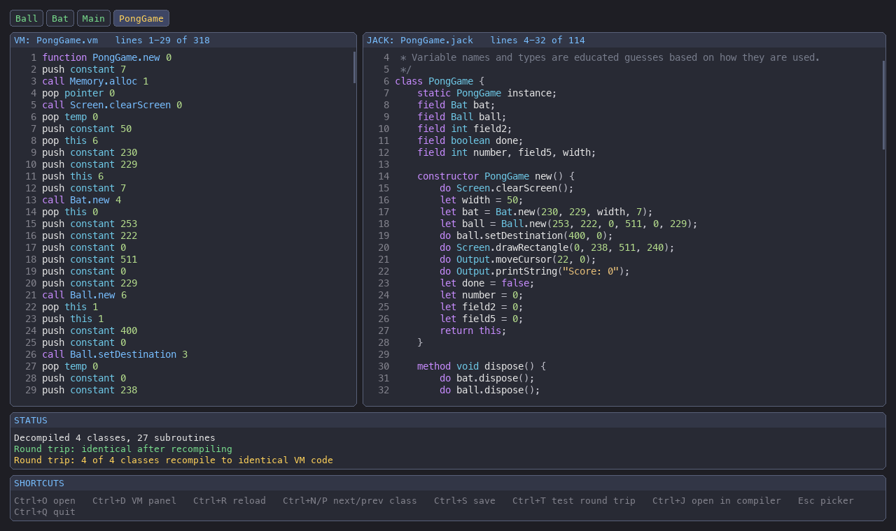

# jack-decompiler

Turn **nand2tetris Jack VM code** (`.vm` files) back into readable **Jack
source** (`.jack`), in a window that looks and works like
[jackvm-py](https://github.com/kpillai2017/jackvm-py).



```
function Square.draw 0              method void draw() {
push argument 0                         do Screen.setColor(true);
pop pointer 0                           do Screen.drawRectangle(x, y, x + size, y + size);
push constant 0                         return;
not                         ──►     }
call Screen.setColor 1
pop temp 0
push this 0
...
```

* **Correct, and it proves it.** Every class can be recompiled with the
  built-in checking compiler and compared with the original, instruction by
  instruction (**Ctrl+T** in the window, `--verify` on the command line).
  All the programs in jackvm-py's `games/` folder, including Space Invaders
  (12 classes, 114 subroutines), come back **identical**.
* **Descriptive names.** A `.vm` file keeps class and subroutine names, but
  every variable is just a number (`local 2`, `this 0`). The decompiler
  guesses names from how each one is used. For example, `getScore()`
  returning `this 3` names field 3 `score`, a counter in `while (v < n)
  { ... let v = v + 1; }` becomes `i`, and `let a[i] = Alien.new(...)`
  names the array `aliens`. `if (x > k) { let x = k; }` makes `k` `maxX`,
  a parameter always given `ball.getX()` is `x` (and the one after it `y`),
  and `16384 + ...`, `c - 48` and `return v;` give `address`, `digit` and
  `result`. Names then flow between callers, constructors and fields over
  a few rounds: constructor parameters follow their fields (`x` / `aX`).
  Meaningless subroutine names such as `f1` are renamed too when the body
  makes it obvious (`getSize`, `setSize`, `dispose`, `new`).
* **Real Jack.** It infers types (`Ball`, `Array`, `boolean`, `char`, ...),
  and writes `ball.move()` rather than `Ball.move(ball)`, `true`, `false`,
  `null`, `"strings"` and `a * b`.
* **Careful with errors.** Bad VM code is reported with the file and line
  of *every* problem. Code that can't be written in Jack (for example a
  hand-written `do-while` jump) is reported precisely. That subroutine
  keeps its VM code in comments, and the rest of the program is still
  decompiled.
* **Never destroys your work.** Hand-written `.jack` files are never
  overwritten (unless you pass `--force`).

---

## 1. What you need

| Tool | Version | Check with |
|------|---------|-----------|
| Python | 3.9 or newer | `python3 --version` |
| pip | any recent | `python3 -m pip --version` |

The only libraries are **pygame** (the window) and **pytest** (the tests).
The command-line decompiler works without pygame.

## 2. Install

```bash
git clone https://github.com/kpillai2017/jack-decompiler.git
cd jack-decompiler
python3 -m venv .venv                 # optional, but keeps things tidy
source .venv/bin/activate             # Windows: .venv\Scripts\activate
python3 -m pip install -r requirements.txt
```

Optional: `pip install -e .` adds a `jackdecomp` command you can run from
any folder.

## 3. Use the window

```bash
python3 -m jack_decompiler                        # choose a program in the file picker
python3 -m jack_decompiler tests/fixtures/pong    # open a folder of .vm files straight away
python3 -m jack_decompiler ~/jackvm-py/games/space-invaders
```

Pick a folder of `.vm` files (one per class, as the nand2tetris compiler
writes them) or a single `.vm` file. Each class gets a tab, with the
original VM code on the left and the Jack code on the right.

### Shortcuts

Hold **Ctrl** (or **Cmd ⌘** on a Mac). They're the same keys as in jackvm,
wherever there's a matching action:

| Shortcut | Action | In jackvm |
|----------|--------|-----------|
| Ctrl+O, or Esc | open another program (the file picker) | Ctrl+O / Esc: file picker |
| Ctrl+D | show / hide the VM panel | show / hide the debugger panel |
| Ctrl+R | reload the `.vm` files and decompile again | restart the program |
| Ctrl+N / Ctrl+P | next / previous class (also Tab / Shift+Tab, or click a tab) | Ctrl+N: step |
| Ctrl+S | save the `.jack` files | – |
| Ctrl+T | **test**: recompile every class and compare with the VM code | – |
| Ctrl+J | save, then open the `.jack` files in [jack-compiler](https://github.com/kpillai2017/jack-compiler)'s window | open sources in jack-compiler |
| Ctrl+Q | quit (closing the window works too) | quit |
| ↑ ↓ PgUp PgDn Home End, mouse wheel | scroll the Jack panel (hold **Shift** for the VM panel) | – |

In the **file picker** (the same keys as jackvm's picker): **Enter** opens a
folder or decompiles a `.vm` file, **Ctrl+Enter** decompiles the selected
folder, **Backspace** / **←** goes up, **→** goes into a folder, and **Esc**
goes back to the program you were looking at (or quits if there's none).
You can also click `[decompile N files]` next to a folder.

### Where Ctrl+S saves

Next to the `.vm` files (`Ball.vm` → `Ball.jack`), which is the usual
nand2tetris layout and where jackvm's Ctrl+J looks for sources. If that
folder already has `.jack` files that this tool didn't write, they're left
alone, and the files go into a `decompiled/` sub-folder instead.

### Opening it from jackvm (Ctrl+U)

In [jackvm-py](https://github.com/kpillai2017/jackvm-py)'s player, **Ctrl+U**
opens the running program here. jackvm finds this app through the
`jack_tools` entry point `decompiler` (after `pip install -e .` in the same
environment), a `jackdecomp` command on the `PATH`, the `JACKDECOMP`
environment variable, or `jackdecomp = <this folder>` under `[apps]` in
`~/.config/jack-tools/config.ini`. The first time it isn't found, jackvm
asks for this folder and saves it in the config file.

### Ctrl+J: the Jack compiler

Ctrl+J finds jack-compiler's window (`jackc-gui`) the same way jackvm does.
One setting works for all the Jack tools:

1. the `JACKC_GUI` environment variable (a command, or `off`);
2. the shared config file `~/.config/jack-tools/config.ini`
   (`%APPDATA%\jack-tools\config.ini` on Windows), e.g.
   ```ini
   [apps]
   jackc = ~/code/jack-compiler    ; its folder; bin/ and .venv/ are searched
   ```
3. `jackc-gui` on the PATH.

## 4. Use the command line

```bash
python3 -m jack_decompiler tests/fixtures/pong -o out/        # write out/*.jack
python3 -m jack_decompiler tests/fixtures/hello-world --stdout
python3 -m jack_decompiler tests/fixtures/pong --verify       # recompile and compare
python3 -m jack_decompiler --help
```

| Option | Meaning |
|--------|---------|
| `-o FOLDER` | write one `.jack` file per class into FOLDER |
| `--stdout` | print the Jack code |
| `--verify` | recompile the Jack code and compare it with the original VM code |
| `--force` | with `-o`: overwrite `.jack` files that this tool didn't write |
| `--keep-function-names` | don't rename meaningless names such as `f1` |
| `--gui` | open the window as well |

Exit codes: **0** = all fine, **1** = some subroutines couldn't be
decompiled or `--verify` found a difference, **2** = bad input (missing
files, VM syntax errors, or a file that won't be overwritten).

From Python:

```python
from pathlib import Path
from jack_decompiler import decompile_files
from jack_decompiler.verify import verify

result = decompile_files([Path("tests/fixtures/pong")])
print(result.classes["Ball"].jack)
print(all(check.ok for check in verify(result)))
```

## 5. Run the tests

```bash
python3 -m pytest            # about 100 tests, under a second or so
```

The GUI tests use SDL's "dummy" video driver, so no window pops up. The
round-trip tests decompile and recompile the sample programs in
`tests/fixtures/`. If a `jackvm-py` checkout sits next to this folder
(or `JACKVM_GAMES` points at a games folder), they also check all of its
games. GitHub Actions runs everything on Linux, macOS and Windows (see
`.github/workflows/tests.yml`).

## 6. How it works

Each file does one job and starts with a long explanation. Read them in this
order:

```
jack_decompiler/
├── vm_reader.py   ① .vm text → checked instructions (every problem, with line numbers)
├── jack_ast.py    ② the Jack syntax tree: Let, Do, If, While, Return, expressions
├── engine.py      ③ run straight-line code symbolically: stack of expressions → statements
├── structure.py   ④ jumps → if / else / while (by the shape of the jumps, not label names)
├── model.py       ⑤ the whole program: classes, subroutines, variables
├── infer.py       ⑥ types, by weighted "votes" from how each variable is used
├── naming.py      ⑦ descriptive names, from scored candidates
├── emitter.py     ⑧ Jack text that compiles back to the same VM code
├── compiler.py    ⑨ a small nand2tetris-style Jack compiler, used to check ⑧
├── verify.py      ⑩ compile back and compare instruction by instruction
├── output.py         saving .jack files safely
├── main.py           the command line
└── gui/              the window: picker.py and viewer.py hold the logic,
                      app.py and drawing.py the pygame part, theme.py the look
```

The trickiest part is ③. The VM is a stack machine, so the decompiler runs
it with *expressions* instead of numbers. For example, `push local 0`, then
`push constant 1`, then `add`, then `pop local 0` becomes
`let i = i + 1;`. Jack compiler patterns such as `call Math.multiply 2` →
`*`, `String.new` + `appendChar` → `"text"`, and the
`pop temp 0 / pop pointer 1 / push temp 0 / pop that 0` array assignment
are recognised along the way.

### Limits

* Names and types are educated guesses. Behaviour is exact; names may not
  match the original source.
* VM code that has no Jack equivalent can't be decompiled: jumps backwards
  out of a condition (`do-while`), `break`/`continue`-style jumps, or
  changing `this` in the middle of a subroutine. It's reported, and the VM
  code is kept in comments.
* VM code from other compilers is understood (the structurer doesn't rely
  on label names). `--verify` may report differences for it, because the
  checking compiler produces the nand2tetris compiler's patterns.

## 7. Related projects

* [jackvm-py](https://github.com/kpillai2017/jackvm-py): runs `.vm` programs, with a debugger.
* [jack-compiler](https://github.com/kpillai2017/jack-compiler): compiles `.jack` to `.vm`.
* [nand2tetris](https://www.nand2tetris.org): the course these tools are for.

## License

MIT, see [LICENSE](LICENSE). The sample programs in `tests/fixtures/`
come from the nand2tetris software suite (see
[tests/fixtures/README.md](tests/fixtures/README.md)).
